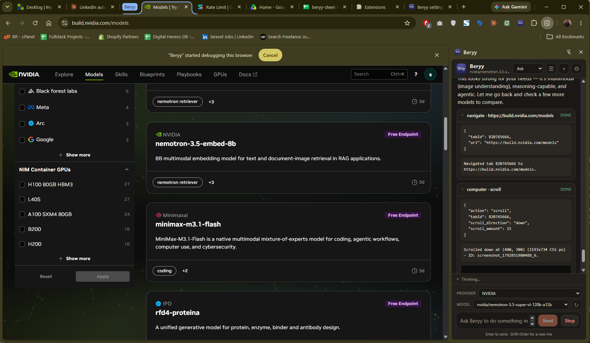
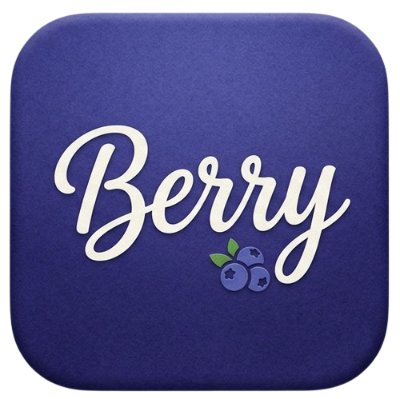

# Beryy

A side-panel browser agent for Chrome that reads, clicks, types, and navigates the web — with your permission.

<p align="center">
  
  <br>
  
</p>

---

## Overview

Beryy lives in your browser's side panel. You give it a goal — *"Find the pricing page and extract the enterprise tier"* — and it drives the browser: scrolling, clicking, filling forms, taking screenshots, and reporting back. Every action requires your permission unless you explicitly grant trust.

**Key capabilities**

| Feature | Details |
|---------|---------|
| **Multi-provider LLM support** | NVIDIA NIM, Google AI Studio, Groq, OpenRouter, local Ollama, or any OpenAI-compatible endpoint |
| **Local models** | Ollama native `/api/chat` streaming with context, GPU, memory, sampling, and timeout controls |
| **Native tool use** | 16 tools for navigation, page reading, clicking and typing, tabs, console/network inspection, screenshots, and plan updates |
| **Cross-origin iframes** | Frame-aware refs, clicks, typing, text extraction, and nested OOPIF support |
| **File uploads** | Attach local files to page or iframe file inputs with explicit upload permission |
| **Vision** | Screenshots sent to vision-capable models (GPT-4o, Gemini, LLaVA, etc.) |
| **Auto context compaction** | Summarizes history at 85% context window; keeps recent 30%, compresses the rest |
| **Tracker blocking** | Declarative Net Request ruleset; allowlists for first-party assets |
| **Anti-bot pacing** | Human-like delays with jitter; respects domain rules |
| **Persistent chats** | Multi-conversation history with titles, restore on reload |
| **Granular permissions** | Ask / Trusted domains / Session grant / Read-only modes |
| **Per-provider accounts** | Separate API keys & models for every provider; switch instantly |
| **Rate limiting** | Optional 40 RPM guard for NVIDIA NIM; configurable Google TPM/RPD/RPM guards; automatic backoff for provider 429/5xx errors |

---

## Quick Start

1. **Install**  
   ```bash
   git clone https://github.com/mshariqq/Beryy---AI-Chrome-extension.git
   cd Beryy---AI-Chrome-extension
   npm install
   ```
   - Open Chrome → `chrome://extensions` → Developer mode → **Load unpacked** → select the `extension/` folder
   - Chrome 125+ is recommended for cross-origin and nested iframe support; Chrome 116+ still supports same-process frames

2. **Configure**  
   - Click the Beryy toolbar icon → **Options**  
   - Choose provider: **NVIDIA NIM**, **Google AI Studio**, **Groq**, **OpenRouter**, **Ollama (local)**, or **Custom**
   - Paste your API key, pick a model, save
   - For Ollama, start it first (`ollama serve`) and pull a model (`ollama pull llama3.2`); no API key is needed

3. **Run**  
   - Open the side panel (toolbar icon)  
   - Type a task: *"Go to example.com, find the pricing link, click it, and tell me the enterprise price"*  
   - Approve each action in the permission prompt (or pre-grant trust)

---

## Control Beryy from opencode

Let an AI model in the [opencode](https://opencode.ai) terminal drive your real Chrome browser through Beryy — the same way opencode integrates Playwright, via a local MCP server.

```bash
node opencode-bridge.js        # start the bridge
```

Then register `opencode-tool/beryy-mcp.js` as an MCP server in `opencode.json`. Full walkthrough: **[BRIDGE_SETUP.md](BRIDGE_SETUP.md)** - protocol details in [BRIDGE_README.md](BRIDGE_README.md).

---

## Screenshots

| Side panel in action | Icon |
|----------------------|------|
|  |  |

---

## Architecture

```
extension/
├── manifest.json          # MV3 manifest
├── background.js          # Service worker: side panel, DNR, tab mgmt
├── content/
│   └── content.js         # Injected script: DOM interaction, refs, clicks
├── sidepanel/
│   ├── index.html         # Side panel UI
│   ├── sidepanel.js       # UI controller, agent bridge
│   ├── agent.js           # Agent loop, tool execution, context mgmt
│   ├── provider.js        # LLM streaming, retries, rate limits, Ollama NDJSON
├── options/
│   ├── options.html       # Settings page
│   ├── options.js         # Provider/key/model and Ollama management
│   └── options.css
├── shared/
│   ├── settings.js        # Settings schema, migration, validation
│   ├── providers.js       # Provider presets (NVIDIA, Google, Groq, OpenRouter, Ollama, Custom)
│   ├── vision.js          # Vision capability detection
│   ├── context.js         # Context estimation, compaction logic
│   ├── rate-limit.js      # NVIDIA and Google request/token limiters
│   ├── tools.js           # Tool definitions & prompt specs
│   ├── prompt.js          # System prompt builder
│   ├── sse.js             # SSE parser for streaming
│   ├── pacing.js          # Anti-bot pacing
│   ├── policy.js          # Permission policies
│   └── tracker-rules.js   # Tracker rule utilities
├── rules/
│   └── trackers.json      # DNR tracker ruleset
└── lib/                   # Minimal polyfills (CDP, tabs, screenshot, etc.)
```

**Data flow**  
User input → `Agent.run()` → `buildMessages()` → `streamChat()` (retries, rate limits) → tool calls → `execute()` → DOM via content script → results → next loop.

---

## Providers

| Provider | Base URL | Default Model | Notes |
|----------|----------|---------------|-------|
| **NVIDIA NIM** | `https://integrate.api.nvidia.com/v1` | `meta/llama-3.3-70b-instruct` | 40 RPM limit (toggleable) |
| **Google AI Studio** | `https://generativelanguage.googleapis.com/v1beta/openai` | `gemma-4-26b-a4b-it` | Free tier; configurable TPM/RPD/RPM |
| **Groq** | `https://api.groq.com/openai/v1` | `openai/gpt-oss-120b` | Fast OpenAI-compatible inference; free tier |
| **OpenRouter** | `https://openrouter.ai/api/v1` | `openrouter/free` | One key for many models; free router |
| **Ollama** | `http://localhost:11434` | `llama3.2` | Local, keyless, native `/api/chat` streaming plus advanced options |
| **Custom** | Your OpenAI-compatible endpoint | — | Any `/v1/chat/completions` endpoint |

### Ollama

Ollama runs models on your own machine. Beryy uses the native `/api/chat` endpoint by default so it can pass context size, GPU layers, threads, sampling, memory, and keep-alive settings. The OpenAI-compatible `/v1` mode is available for basic compatibility but ignores the Ollama-only options.

1. Install Ollama and start it (`ollama serve`).
2. Pull a model, for example `ollama pull llama3.2`.
3. In Beryy options choose **Ollama (local)** and set the model name. No API key is required.
4. Beryy automatically rewrites the browser `Origin` header for requests to `localhost` and `127.0.0.1`, so no Ollama service changes are needed for a normal local install.
5. For a custom Ollama host or reverse proxy, allow the extension origin there (or set `OLLAMA_ORIGINS`) and restart Ollama. On Windows PowerShell:
   ```powershell
   $env:OLLAMA_ORIGINS="*"; ollama serve
   ```

The **Speed preset** fills the advanced fields; you can then adjust anything. Lower `num_ctx`, GPU layers, batch size, and thread count reduce memory use. Increase **Request timeout** if a large model needs time to load, and use `keep_alive` to keep it resident between replies.

### Free-tier notes

Limits change; these were checked against provider documentation in October 2026.

- **Groq (`openai/gpt-oss-120b`)**: about 30 RPM, 8K tokens/minute, 1,000 requests/day, and 200K tokens/day per organization. `retry-after` is returned on 429, and Beryy honors it.
- **OpenRouter**: free model IDs and `openrouter/free` are limited to 20 requests/minute and 50 requests/day. Buying at least $10 of credits raises the daily cap to 1,000. Failed attempts count toward the cap. Some free models require enabling free-model publication in OpenRouter privacy settings.
- **Google AI Studio**: free-tier quotas vary by model. Beryy defaults to **150,000 TPM**, **50 RPD**, and **10 RPM**, and waits before a request would exceed those limits. All three values are editable in Google settings; TPM reserves the estimated prompt plus max output tokens. Beryy also retries 429 and 503 responses automatically.
- **NVIDIA NIM**: the optional 40 RPM guard spaces requests before they are sent; provider-side 429s are still retried with backoff.

> **Vision**: Only sent when `settings.vision=true` **and** the model matches a known vision pattern (GPT-4o, Gemini, LLaVA, etc.). Text-only models (Llama 3.x, Nemotron 3/4, GPT-OSS, etc.) never receive screenshots. `openrouter/free` routes to a model that accepts the request's features.

---

## Settings Reference

| Setting | Description |
|---------|-------------|
| `provider` | Active provider: `nvidia`, `google`, `groq`, `openrouter`, `ollama`, `custom` |
| `providerAccounts` | Per-provider `{baseUrl, apiKey, model}` |
| `ollama` | Ollama options: `apiMode`, `keepAlive`, `numCtx`, `numPredict`, `numGpu`, `numThread`, `numBatch`, `numKeep`, `topK`, `topP`, `minP`, `repeatPenalty`, `repeatLastN`, `presencePenalty`, `frequencyPenalty`, `seed`, `stop`, `think`, `flashAttn`, `kvCacheType`, `useMmap`, `useMlock`, `requestTimeoutMs`, `idleTimeoutMs` |
| `nvidiaRateLimit` | Enforce 40 RPM for NVIDIA (default: on) |
| `googleTpm` | Google tokens per minute guard (default: 150000) |
| `googleRpd` | Google requests per day guard (default: 50) |
| `googleRpm` | Google requests per minute guard (default: 10) |
| `vision` | Enable screenshot upload for vision models |
| `toolMode` | `auto` (native tools) / `prompt` (XML fallback) |
| `maxSteps` | Max agent steps per turn (default: 12, max: 800) |
| `maxTokens` | Output token limit |
| `temperature` | Sampling temperature |
| `blockedDomains` | Comma-separated domains to block |
| `trustedDomains` | Domains that auto-grant permission |
| `permissionMode` | `ask` / `trusted` / `session` / `read_only` |
| `pacingEnabled` | Human-like delay between actions |
| `baseDelayMs` / `jitterMs` | Pacing parameters |

---

## Testing

```bash
npm run verify   # lint + unit tests
```

Tests cover:
- Settings migration & validation
- Provider streaming, `Retry-After`/backoff retries, and rate limits
- Agent loop, tool execution, context compaction
- Vision gating, screenshot pruning
- Tracker blocking & DNR allowlist
- SSE parsing, tool-call extraction

---

## Security & Privacy

- **No telemetry** — zero network calls except to your configured LLM endpoint
- **API keys stored locally** in `chrome.storage.local` (never synced)
- **All URLs allowed** by `<all_urls>` host permission; you control which sites the agent visits
- **No hardcoded secrets** — placeholders only (`nvapi-…`, `AIza…`, `gsk_…`, `sk-or-v1-…`)
- **Content Security Policy** compliant — no inline scripts, no `eval`

---

## Contributing

1. Fork → feature branch → PR
2. `npm run verify` must pass
3. Follow existing code style (ES modules, no build step, vanilla JS)
4. Add tests for new behavior

---

## Developer

**SHA REEQ** — Developer from Hyderabad, India  
🌐 Portfolio: [https://mshariqq.github.io](https://mshariqq.github.io)  
💬 Contact: [WhatsApp](https://wa.me/917997807419)

---

## Support

If you find Beryy useful, consider buying me a coffee:

[](https://wa.me/917997807419)

---

## License

MIT — see [LICENSE](LICENSE).

---

## Acknowledgments

- Built for Chrome MV3 with side panel API
- Inspired by open-source browser agents and the open LLM ecosystem
- Tracker ruleset derived from public filter lists

---

<p align="center">
  
  <br>
  <strong>Beryy</strong> — Your browser, automated.
</p>